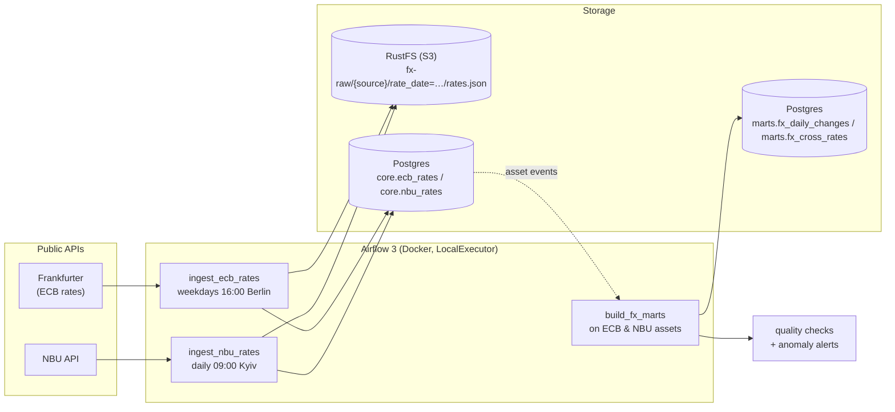

# fx-rates-airflow

A small but complete **Apache Airflow 3** project: every day it collects official
exchange rates from two central banks, keeps the raw responses in object storage,
loads them into a Postgres warehouse, builds analytical tables, checks data quality
and raises alerts on unusual moves.

It is a learning project. The business logic is deliberately simple so the focus
stays on **how Airflow works** and on the patterns used in production pipelines:
idempotent loads, backfills, sensors, retries, assets (data-aware scheduling),
dynamic task mapping, branching, pools, connections, variables and DAG tests.

| Source | What | When | API |
| --- | --- | --- | --- |
| **ECB**, European Central Bank | ~30 currencies per 1 EUR | business days, ~16:00 CET | [Frankfurter](https://frankfurter.dev) |
| **NBU**, National Bank of Ukraine | UAH per 1 unit of ~45 currencies | every calendar day, set the day before | [NBU open data](https://bank.gov.ua/ua/open-data/api-dev) |

Both APIs are free and need no key.

## Architecture



- **Raw layer** (RustFS, S3-compatible): the API response exactly as received, one file per source and day.
- **Core layer** (Postgres `core.*`): clean, validated rates, one row per day and currency.
- **Marts** (Postgres `marts.*`): day-over-day changes, and a cross-check of the two banks
  (NBU rate vs the rate implied by the ECB).

Details and design decisions: [docs/architecture.md](docs/architecture.md).

## Quick start

Requirements: Docker Desktop (about 3 GB of RAM for the stack), [uv](https://docs.astral.sh/uv/) and `make`.

```bash
make setup   # local uv env + .env with generated secrets
make test    # unit + DAG integrity tests, no Docker needed
make up      # build the image and start Airflow, Postgres and RustFS
make unpause # the DAGs start paused
```

| What | Where |
| --- | --- |
| Airflow UI | <http://localhost:8080> (port = `AIRFLOW_PORT` in `.env`), no login |
| RustFS console (raw files) | <http://localhost:9001/rustfs/console/> (`S3_ACCESS_KEY` / `S3_SECRET_KEY` from `.env`) |
| Warehouse | `postgresql://fx:fx@localhost:5433/fx` (DBeaver, psql, …) or `make psql` |

Once unpaused, each ingest DAG runs once for its latest scheduled day. Load some history with a backfill:

```bash
make backfill FROM=2026-10-01 TO=2026-11-01
```

`build_fx_marts` then runs by itself when both sources have new data.

## Everyday commands

```bash
make help                          # list all commands
make ps / make logs                # container health / follow Airflow logs
make trigger DAG=ingest_nbu_rates  # run a DAG now
make airflow CMD="dags list"       # any Airflow CLI command
make down                          # stop (data is kept)
make reset                         # stop and delete ALL data
```

More in the runbook: [docs/runbook.md](docs/runbook.md).

## Project layout

```
fx-rates-airflow/
├── dags/                       # DAG definitions only: schedule, task order, retries
│   ├── ingest_ecb_rates.py     # sensor -> raw -> core, skips ECB holidays
│   ├── ingest_nbu_rates.py     # raw -> core, waits for late data with retries
│   ├── build_fx_marts.py       # asset-triggered marts, mapped quality checks, branching
│   ├── fx_shared/              # Airflow glue shared by DAGs (assets, settings, helpers)
│   └── .airflowignore
├── src/fx_pipeline/            # business logic, no Airflow imports, unit-tested
│   ├── ecb.py / nbu.py         # API clients + parsing
│   ├── validation.py           # checks before loading
│   ├── storage.py              # raw file naming + idempotent "replace day" load
│   └── marts.py                # date range logic, quality rules, alert text
├── sql/                        # DDL and mart SQL (Jinja-templated by Airflow)
├── tests/                      # pytest: logic + DAG integrity
├── scripts/                    # bootstrap (DB migrate, pool, bucket), .env generator
├── docs/                       # architecture, Airflow concepts, runbook, exercises
├── Dockerfile                  # official Airflow image + this package
├── docker-compose.yaml         # the whole local stack
├── Makefile                    # shortcuts
└── pyproject.toml / uv.lock    # dependencies (uv)
```

The main rule: **DAG files stay thin, logic lives in `src/`.** The logic can be tested
without Airflow, and the DAG files only describe *when* and *in what order* things run.

## Learning material

- [docs/project-summary.md](docs/project-summary.md): the whole project on one page,
  with a 30-second pitch and the problems solved along the way.
- [docs/airflow-concepts.md](docs/airflow-concepts.md): every Airflow concept used here,
  where to find it in the code and in the UI, and common interview questions.
- [docs/exercises.md](docs/exercises.md): small changes to try yourself.

## Tech stack

Apache Airflow 3.4 · Python 3.12 · uv · Docker Compose · PostgreSQL 16 ·
RustFS (S3-compatible) · pytest · ruff
