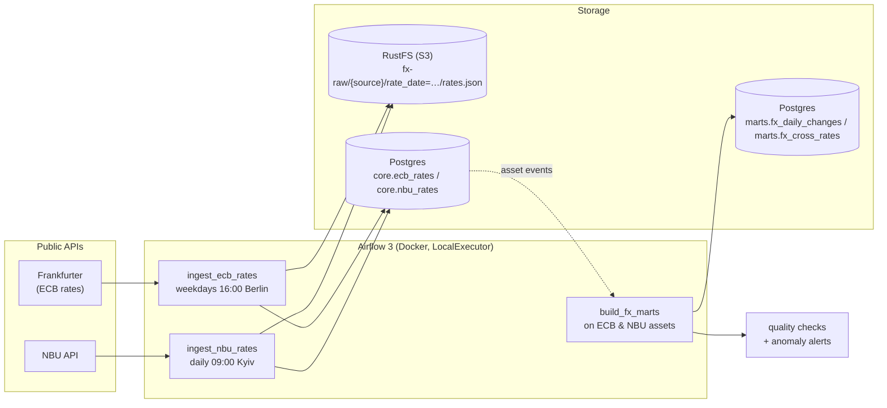

<div align="center">

# fx-rates-airflow

**Daily exchange rates from two central banks, orchestrated with Apache Airflow 3.**<br>
Raw files in S3, a Postgres warehouse, data quality checks and anomaly alerts, started with one `make up`.

[](https://github.com/DmytroPalahin/fx-rates-airflow/actions/workflows/ci.yml)
[](https://github.com/DmytroPalahin/fx-rates-airflow/releases)
[](LICENSE)
<br>


[](https://github.com/astral-sh/uv)
[](https://github.com/astral-sh/ruff)

[Quick start](#quick-start) ·
[Architecture](#architecture) ·
[Airflow features](#airflow-features) ·
[Documentation](#documentation) ·
[Project summary](docs/project-summary.md)

</div>

## About

Every day the pipeline collects the official exchange rates of the **European Central Bank**
and the **National Bank of Ukraine**, keeps the raw API responses in object storage, loads
validated rates into a Postgres warehouse, builds analytical tables, checks data quality and
raises alerts on unusual moves.

It is a learning project. The business logic is deliberately simple, so the focus stays on
**how Airflow works** and on the patterns of production pipelines: idempotent loads, backfills,
sensors, retries, data-aware scheduling, dynamic task mapping and DAG tests.

| Source | What | When | API |
| --- | --- | --- | --- |
| **ECB**, European Central Bank | ~30 currencies per 1 EUR | business days, ~16:00 CET | [Frankfurter](https://frankfurter.dev) |
| **NBU**, National Bank of Ukraine | UAH per 1 unit of ~45 currencies | every calendar day, set the day before | [NBU open data](https://bank.gov.ua/ua/open-data/api-dev) |

Both APIs are free and need no key.

## Highlights

- **Three layers.** Raw JSON in S3-compatible storage, validated rates in `core`, analytical
  tables in `marts`: day-over-day changes and a cross-check of the two banks.
- **Idempotent loads.** Every task can be retried, cleared or backfilled without creating
  duplicates: deterministic raw keys and a delete + insert of the whole day in one transaction.
- **Late data, two strategies.** The ECB waits behind a sensor in *reschedule* mode that also
  recognises holidays and skips them. The NBU, which publishes every day, relies on retries.
- **Chained by data, not by time.** The marts DAG is triggered by assets once both sources have
  new data. Each event carries its date, so one run rebuilds exactly the days that changed.
- **Data quality.** Five checks run as mapped tasks after every build; anomalies over a
  configurable threshold go down an alert branch.
- **Thin DAGs.** The logic lives in a plain Python package without Airflow imports, covered by
  unit tests. The DAG files only say *when* and *in what order*.

## Architecture



- **Raw layer** (RustFS, S3-compatible): the API response exactly as received, one file per source and day.
- **Core layer** (Postgres `core.*`): clean, validated rates, one row per day and currency.
- **Marts** (Postgres `marts.*`): day-over-day changes, and a cross-check of the two banks
  (NBU rate vs the rate implied by the ECB).

Details and design decisions: [docs/architecture.md](docs/architecture.md).

## Airflow features

| Feature | Where |
| --- | --- |
| TaskFlow API (`@task`), XCom through return values | all DAGs |
| `SQLExecuteQueryOperator` with templated `.sql` files | table creation, mart builds |
| Hooks and connections (`S3Hook`, `PostgresHook`, `AIRFLOW_CONN_*`) | load tasks |
| `CronTriggerTimetable` with a time zone | both ingest DAGs |
| Sensor in reschedule mode, `AirflowSkipException` | ECB `wait_for_publication` |
| Retries, `AirflowFailException` for bad data | NBU extract, `load_to_core` |
| Assets with event metadata, `schedule=(A & B)` | ingest → `build_fx_marts` |
| Dynamic task mapping, TaskGroup | quality checks |
| Branching, `EmptyOperator` | anomaly alerts |
| Params, Variables, pools | manual runs, thresholds, API rate limiting |
| Backfills | `make backfill` |

Each one is explained, with where to see it in the UI, in
[docs/airflow-concepts.md](docs/airflow-concepts.md).

## Quick start

Requirements: Docker Desktop (about 3 GB of RAM for the stack), [uv](https://docs.astral.sh/uv/) and `make`.

```bash
make setup   # local uv env + .env with generated secrets
make test    # unit + DAG integrity tests, no Docker needed
make up      # build the image and start Airflow, Postgres and RustFS
make unpause # the DAGs start paused
```

| What | Where |
| --- | --- |
| Airflow UI | <http://localhost:8080> (port = `AIRFLOW_PORT` in `.env`), no login |
| RustFS console (raw files) | <http://localhost:9001/rustfs/console/> (`S3_ACCESS_KEY` / `S3_SECRET_KEY` from `.env`) |
| Warehouse | `postgresql://fx:fx@localhost:5433/fx` (DBeaver, psql, …) or `make psql` |

Once unpaused, each ingest DAG runs once for its latest scheduled day. Load some history with a backfill:

```bash
make backfill FROM=2026-10-01 TO=2026-11-01
```

`build_fx_marts` then runs by itself when both sources have new data.

### Everyday commands

```bash
make help                          # list all commands
make ps / make logs                # container health / follow Airflow logs
make trigger DAG=ingest_nbu_rates  # run a DAG now
make airflow CMD="dags list"       # any Airflow CLI command
make down                          # stop (data is kept)
make reset                         # stop and delete ALL data
```

More in the runbook: [docs/runbook.md](docs/runbook.md).

## Project layout

```
fx-rates-airflow/
├── dags/                       # DAG definitions only: schedule, task order, retries
│   ├── ingest_ecb_rates.py     # sensor -> raw -> core, skips ECB holidays
│   ├── ingest_nbu_rates.py     # raw -> core, waits for late data with retries
│   ├── build_fx_marts.py       # asset-triggered marts, mapped quality checks, branching
│   ├── fx_shared/              # Airflow glue shared by DAGs (assets, settings, helpers)
│   └── .airflowignore
├── src/fx_pipeline/            # business logic, no Airflow imports, unit-tested
│   ├── ecb.py / nbu.py         # API clients + parsing
│   ├── validation.py           # checks before loading
│   ├── storage.py              # raw file naming + idempotent "replace day" load
│   └── marts.py                # date range logic, quality rules, alert text
├── sql/                        # DDL and mart SQL (Jinja-templated by Airflow)
├── tests/                      # pytest: logic + DAG integrity
├── scripts/                    # bootstrap (DB migrate, pool, bucket), .env generator
├── docs/                       # summary, architecture, Airflow concepts, runbook, exercises
├── Dockerfile                  # official Airflow image + this package
├── docker-compose.yaml         # the whole local stack
├── Makefile                    # shortcuts
└── pyproject.toml / uv.lock    # dependencies (uv)
```

## Documentation

| | |
| --- | --- |
| [docs/project-summary.md](docs/project-summary.md) | The whole project on one page, with the problems solved along the way |
| [docs/architecture.md](docs/architecture.md) | Components, data flow, data model and design decisions |
| [docs/airflow-concepts.md](docs/airflow-concepts.md) | Every Airflow concept used here, Airflow 2 vs 3, interview questions |
| [docs/runbook.md](docs/runbook.md) | Operating the stack: backfills, reruns, useful SQL, troubleshooting |
| [docs/exercises.md](docs/exercises.md) | Small changes to try yourself |
| [CHANGELOG.md](CHANGELOG.md) | What changed between versions |

## Development

```bash
make lint test   # ruff (lint + format check), then pytest
make fmt         # auto-format and auto-fix
```

CI runs the same checks on every push and pull request, and builds the Airflow image.
[CONTRIBUTING.md](CONTRIBUTING.md) covers the conventions and the release process.

## Roadmap

- Slack or Telegram notifications instead of log lines
- A deferrable wait before the ECB publication time
- A third source (National Bank of Poland)
- The marts as a dbt project, run from Airflow with Cosmos

## License

[MIT](LICENSE) © 2026 Dmytro Palahin
