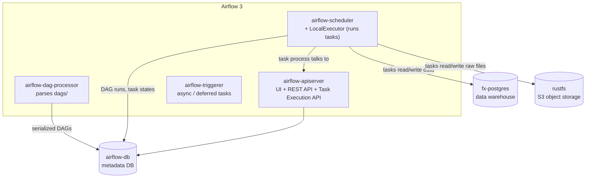

# Architecture

## Components (docker-compose)



| Service | Role |
| --- | --- |
| `airflow-apiserver` | Serves the UI and the REST API. In Airflow 3 it also serves the **Task Execution API**: running tasks get their connections, variables and XComs through it and never touch the metadata DB directly. |
| `airflow-scheduler` | Creates DAG runs from schedules and asset events, decides which tasks are ready and hands them to the executor. With **LocalExecutor** tasks run as subprocesses inside this container. |
| `airflow-dag-processor` | Parses the files in `dags/` (every 30 s here) and stores *serialized* DAGs in the metadata DB. The scheduler and UI only read the serialized version. |
| `airflow-triggerer` | Runs the async triggers of deferred tasks. Not used by these DAGs, but part of a standard deployment (see the deferrable exercise). |
| `airflow-db` | Airflow's **metadata** DB: DAG runs, task instances, XComs, pools… Never put business data here. |
| `fx-postgres` | The **data warehouse**: `core` and `marts` schemas. |
| `rustfs` | S3-compatible object storage holding the raw layer. MinIO used to be the usual choice; its community Docker images stopped being published in 2025, so RustFS is used instead. Airflow talks to it through the regular Amazon provider (`S3Hook`). |
| `airflow-init` | One-off job (`scripts/bootstrap.sh`): migrates the metadata DB, creates the `fx_api` pool and the `fx-raw` bucket. |

**Why LocalExecutor?** One machine, few tasks: it is the simplest executor that runs tasks in
parallel. CeleryExecutor (Redis + worker containers) or KubernetesExecutor (one pod per task)
matter when tasks must spread over several machines. The DAG code is the same for all of them.

## Data flow

```
                ┌──────────── ingest_ecb_rates (weekdays 16:00 Europe/Berlin) ────────────┐
Frankfurter ──> │ wait_for_publication ─> extract_to_raw ─> load_to_core                    │
                │        (sensor)            │                  │  outlet: fx_core_ecb_rates │
                └────────────────────────────┼──────────────────┼────────────────────────────┘
                                             ▼                  ▼
                   s3://fx-raw/ecb/rate_date=…/rates.json   core.ecb_rates
                                                                │
                ┌──────────── ingest_nbu_rates (daily 09:00 Europe/Kyiv) ─────────────────┐
NBU API ──────> │ extract_to_raw (retries) ─> load_to_core                                  │
                │                              │  outlet: fx_core_nbu_rates                 │
                └──────────────────────────────┼────────────────────────────────────────────┘
                                               ▼
                                         core.nbu_rates
                                               │
                     both assets updated ──────┘
                                               ▼
                ┌──────────── build_fx_marts (schedule = ECB_RATES & NBU_RATES) ──────────┐
                │ resolve_date_range ─> build_fx_daily_changes ─┐                           │
                │                    └> build_fx_cross_rates  ──┴> quality_checks[5]       │
                │ ─> find_anomalies ─> route_alerts ─> report_anomalies | no_anomalies      │
                └───────────────────────────────────────────────────────────────────────────┘
```

## Data model

| Table | Grain | Meaning of `rate` |
| --- | --- | --- |
| `core.ecb_rates` | `(rate_date, currency)`, business days only | units of currency per **1 EUR** |
| `core.nbu_rates` | `(rate_date, currency)`, every calendar day | **UAH** per 1 unit of currency |
| `marts.fx_daily_changes` | `(source, rate_date, currency)` | `pct_change` vs the previous publication. NULL on the first day or after a gap in the loaded history. |
| `marts.fx_cross_rates` | `(rate_date, currency)`, days where both sources exist | `deviation_pct` = NBU direct rate vs the rate implied by the ECB: `NBU UAH/EUR ÷ ECB currency/EUR` |

The NBU sets the rate for day D on D-1, while the ECB fixes it on D. A deviation of a few
tenths of a percent is therefore normal. The alert threshold defaults to 1 %.

## Design decisions

### 1. Thin DAGs, logic in a package

`dags/*.py` only describe *when* and *in what order*. Everything else (HTTP calls,
parsing, validation, SQL loading) is in `src/fx_pipeline` and has no Airflow imports.

- It is unit-tested without Airflow (`tests/test_ecb.py`, …).
- DAG files parse fast. The dag-processor re-imports them every 30 s, so heavy top-level code would slow down the whole platform.
- The logic could move to another orchestrator unchanged.

`dags/fx_shared/` holds the small amount of Airflow-specific glue the DAGs share
(asset definitions, connection ids, default args). It is in `.airflowignore` because it contains no DAGs.

### 2. Idempotency everywhere

Re-running any task for the same day gives the same result as running it once:

- Raw files have a deterministic key (`ecb/rate_date=2026-11-06/rates.json`) and are overwritten.
- `core` loads use **delete + insert of the whole day in one transaction** (`storage.replace_day`).
  Compared with `INSERT … ON CONFLICT`, this also removes currencies that disappeared from the source.
- Marts are rebuilt for a date range with the same delete + insert pattern.

That makes retries, `Clear` in the UI and backfills safe. The re-run of 2 already loaded
days was tested: row counts stayed the same, `loaded_at` changed.

### 3. The day a run loads comes from the schedule, not from "now"

Tasks compute the target day from `logical_date` (see `fx_shared/runtime.py`). They never
call `date.today()`, otherwise a backfill for October would load today's rates 20 times.
Manual runs in Airflow 3 can have no `logical_date`; then `run_after` is used.

### 4. XCom carries references, not data

`extract_to_raw` returns the **object key** (a short string); `load_to_core` reads the file
from S3. XCom lives in the metadata DB and is meant for small values. The only "data" in
XCom is the list of anomalies, which is a handful of rows by construction.

### 5. Two ways to wait for late data

- ECB: a **sensor** in `reschedule` mode polls every 10 min and frees its worker slot between polls.
  It knows the ECB calendar: a weekend day (only possible in a manual run) is **skipped** at once;
  a weekday still without a publication after 21:00 Berlin is a holiday and is **skipped** too, not failed.
- NBU: no sensor. If the rate is not out yet the task **fails and is retried** (6 × 15 min).
  Simpler, but the run shows as "up for retry" while waiting.

### 6. Data-aware scheduling with assets

`build_fx_marts` has no cron: `schedule=(ECB_RATES & NBU_RATES)`. It runs once **both**
assets got new events since its last run. Each event carries `extra={"rate_date": …}`,
so the marts DAG rebuilds exactly the days that changed, even after a backfill of
weeks of data (Airflow merges many events into one run).

Consequence of the `&`: an NBU event for Saturday waits until the ECB publishes on Monday.
The marts are therefore eventually consistent, at most one ECB publication behind.

### 7. Fail fast on bad data, retry on flaky infrastructure

Network errors and "not published yet" raise normal exceptions, so Airflow **retries**
them with exponential backoff. Validation errors raise `AirflowFailException`, so the task
fails **immediately without retries**: bad data does not fix itself.

### 8. Secrets outside the code

Connections are injected as `AIRFLOW_CONN_*` environment variables from `.env`
(git-ignored). The DAGs only know connection *ids*. The Fernet key that encrypts secrets
stored in the metadata DB is generated by `make env`.

## What would change in production

- Managed Airflow (MWAA, Cloud Composer, Astronomer) or Helm on Kubernetes instead of compose;
  CeleryExecutor or KubernetesExecutor.
- Real authentication (`SimpleAuthManager` with all-admins is for local use only).
- A secrets backend (Vault, AWS Secrets Manager) instead of `.env`.
- Logs shipped to S3 / Elasticsearch (remote logging).
- Alerts sent through a provider notifier (Slack, Teams, email) instead of the log.
- DAG deployment through CI/CD: lint + tests on every PR, then sync `dags/` or ship a new image.
- dbt for the marts if they grow beyond a few SQL files.
